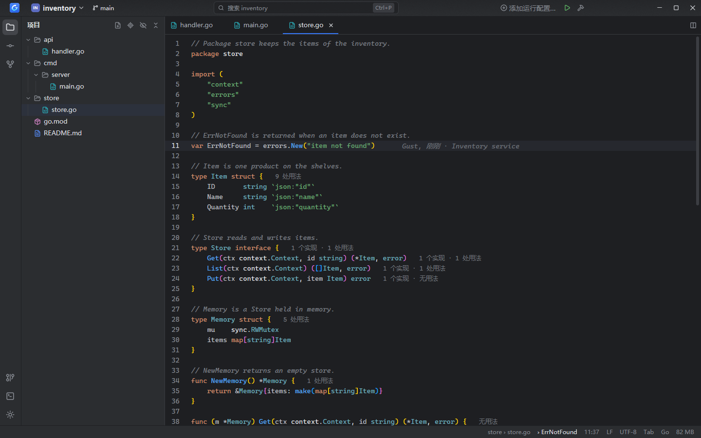

<div align="center">


# Gust

**轻量、快速的 Go 集成开发环境**

面向以阅读、审查和修改代码为主的工作方式，适合与 AI 编程助手配合使用

[](https://github.com/florune/gust/releases/latest)
[](LICENSE)


</div>



## 简介

Gust 使用 Rust 编写，界面基于 GPU 渲染的 [GPUI Kit](https://gpui-kit.com)，以单个可执行文件发布，不依赖 WebView、JVM 或语言服务器。启动迅速、内存占用低，键位与交互沿用 GoLand 的习惯。

## 特性

- **代码导航**：补全、跨包跳转定义、查找用法与接口实现、按名称查找符号、快速文档、重命名。由内置的 tree-sitter 索引提供，不依赖 gopls。
- **用法数量**：函数、方法、类型的声明行末尾显示被引用的次数，接口另显示实现数量，修改前即可判断影响范围。
- **Git**：提交、推送、拉取、分支与暂存；改动标记与按块回滚；行内 blame；Git 日志与提交图；GoLand 式的合并冲突处理。
- **工作树（worktree）**：一个面板管理同一仓库的多个检出，适合多个 AI 助手并行工作：新建、审阅改动、按块撤销、合并回主分支、清理。
- **运行与测试**：运行配置、编译错误与 `go vet` 标记、在编辑器中运行单个测试，输出在内置终端中。
- **编辑体验**：彩色括号、扩大选区、多光标与列选择、分屏、意图操作、代码模板、本地历史。
- **外观**：14 套深色与浅色主题，快捷键可自定义。

## 下载与安装

从 [Releases](https://github.com/florune/gust/releases/latest) 下载 `gust-<版本>-windows-x86_64.zip`，解压后运行 `gust.exe`，无需安装。

运行环境：

| 依赖 | 说明 |
| --- | --- |
| Windows 10 / 11（x64） | 目前仅提供 Windows 版本 |
| [Go](https://go.dev/dl/) | 编译、运行、测试、格式化 |
| [Git](https://git-scm.com/) | 版本控制相关功能 |
| `goimports`（可选） | 检测到时，保存时用它代替 `gofmt` 整理导入 |

> 发布的可执行文件未经代码签名，首次运行时 Windows SmartScreen 可能提示风险，选择「仍要运行」即可。也可以按下文从源码构建。

## 从源码构建

需要 Rust 1.85 或更高版本（2024 edition）。

```bash
git clone https://github.com/florune/gust.git
cd gust
cargo build --release
```

生成的程序位于 `target/release/gust.exe`。

## 使用

| 命令 | 说明 |
| --- | --- |
| `gust <文件夹>` | 打开项目 |
| `gust <文件夹> <文件…>` | 打开项目及指定文件 |
| `gust <文件>` | 打开文件所在的文件夹及该文件 |
| `gust` | 从命令行启动时打开当前目录；从资源管理器或开始菜单启动时打开最近的项目 |

## 功能详情

### 编辑

- 语法高亮：Go、JSON、YAML、TOML、Markdown、SQL、Protobuf、Shell、Makefile、Diff。
- 保存 Go 文件时自动格式化；`Ctrl+Alt+L` 格式化 Go 与 JSON。
- 行操作：注释、复制、删除、上下移动，每个操作可用一次撤销还原。
- 扩大 / 缩小选区：Go 文件按语法结构逐级扩大，其他文件按词、括号、行。
- 鼠标操作：`Ctrl+点击` 跳转，`Alt+拖动` 列选择，`Alt+Shift+点击` 添加光标，中键自动滚动。
- 分屏：同一文件或不同文件左右并排，两侧编辑实时同步。
- 彩色括号：按嵌套层级着色，未配对的括号标红；光标旁的括号与其配对的另一半同时框出。
- 意图操作（`Alt+Enter`）：为结构体字段添加 json 标签、为类型生成接口方法、运行 `go mod tidy`。
- 代码模板：输入 `iferr`、`fori`、`forr`、`forv` 后按 Tab 展开；`iferr` 按所在函数的返回值生成零值。

### 代码导航

- 补全：局部变量、包内符号、结构体字段与方法、导入包（含标准库与依赖）的成员。
- 跳转到定义，可跨文件、跨包；后退 / 前进，支持鼠标侧键。
- 用法与实现：列出函数、方法、类型、字段、变量的引用；接口及其方法同时列出实现。
- 用法数量：声明行末尾显示用法与实现数量，点击列出全部位置；保存后更新，可在设置中关闭。
- 文件结构、按名称查找符号（支持 `类型.方法`）、快速文档（悬停或 `Ctrl+Q`）、重命名符号。
- 查找文件支持 `文件:行号`，可直接粘贴日志与堆栈中的位置；全局文本搜索与替换。

导航功能由内置的符号索引提供，按名称解析声明，不做完整的类型推断。

### 编译与运行

- 打开或保存文件后在后台检查所在的包，编译错误与 `go vet` 结果以波浪线标出并在状态栏汇总。
- 运行配置：包路径、工作目录、程序参数、环境变量、构建参数、输出文件，按项目保存。构建在包所属的 Go 模块中进行，`go.mod` 位于子目录时同样适用。
- 测试：测试函数旁的标记运行单个测试，`Ctrl+Shift+F10` 运行光标所在的测试或整个包。
- 输出显示在内置终端中，可交互；其中的 `文件:行号` 可点击跳转。

### Git

- 提交面板：改动列表、选择性提交、修改上次提交、推送、拉取。
- 分支：新建、切换（可按名称搜索）、暂存与恢复（stash）。
- 改动标记：行号旁标出新增、修改、删除的行，可查看原内容并按块回滚。
- 行内 blame、左右对比视图、Git 日志（分支、提交图、提交详情与文件差异）。
- 合并冲突：提交面板提示冲突；在合并窗口中左右对照，逐处选择保留或舍弃，冲突之外双方的改动自动保留；全部解决后正常提交。

### 工作树

- 面板列出仓库的所有工作树：分支、未提交改动数、相对主分支的领先 / 落后提交数、最近活动时间，已合并的标为「可删除」。
- 新建：选择已有分支或新建分支，默认放在仓库旁的 `仓库名.worktrees\分支名`；可复制 `.env` 等 Git 不跟踪的本地文件，继承运行配置并覆盖环境变量（如为每个工作树分配不同端口）。
- 审阅改动：以对比视图列出工作树相对分叉点的全部改动（含未提交的），可按块撤销。
- 合并回主分支：压缩为一个提交、合并提交或变基后快进；有冲突时转入冲突处理流程；完成后可一并删除工作树与分支。
- 在任意文件上与其他工作树中的同一文件比较；为工作树设置标记颜色，显示在面板与标题栏。

### 工作区

- 文件树：新建、重命名、删除（移至回收站）；按项目隐藏文件或文件夹，隐藏的内容不参与搜索。
- 外部修改自动同步；与未保存的修改冲突时，可比较、逐块合并或保留任一方。
- 自动保存：切换窗口、关闭标签、运行或提交前保存。
- 本地历史：保存、外部修改、回滚、替换之前保留旧版本，可比较与恢复。
- 重新打开项目时恢复标签页、光标位置与最近文件；最近项目列表，可在当前窗口或新窗口中打开。
- 标签栏：可拖动排序，放不下时可滚动，并可列出全部标签。
- Markdown 预览（源码 / 预览 / 并排）、内置终端（多标签、输入法、复制）。
- 设置（`Ctrl+Alt+S`）：主题、代码字号（`Ctrl+滚轮` 缩放）、保存时格式化、行内 blame、悬停文档、用法数量、彩色括号。
- 操作搜索（`Ctrl+Shift+A`）：按名称查找并执行任意命令。

## 快捷键

默认键位沿用 GoLand，可在应用菜单（标题栏左上角的图标）的「快捷键」中修改。

| 快捷键 | 功能 |
| --- | --- |
| 两次 `Shift` / `Ctrl+P` | 查找文件 |
| `Ctrl+Shift+A` | 操作搜索 |
| `Ctrl+Shift+F` / `Ctrl+Shift+R` | 全局搜索 / 全局替换 |
| `Ctrl+N` | 查找符号 |
| `Ctrl+E` | 最近文件 |
| `Ctrl+F` / `Ctrl+R` | 查找 / 替换 |
| `Ctrl+B` / `F12` | 跳转到定义；在声明处列出用法 |
| `Alt+F7` / `Ctrl+Alt+B` | 用法与实现 |
| `Ctrl+F12` / `Ctrl+Alt+O` | 文件结构 |
| `Ctrl+Q` | 快速文档 |
| `Shift+F6` | 重命名符号 |
| `Alt+Enter` | 意图操作 |
| `Ctrl+Alt+←` / `Ctrl+Alt+→` | 后退 / 前进 |
| `Ctrl+Space` | 补全 |
| `Ctrl+S` | 保存 |
| `Ctrl+Alt+L` / `Shift+Alt+F` | 格式化 |
| `Ctrl+/` | 注释 / 取消注释 |
| `Ctrl+D` / `Ctrl+Y` | 复制行 / 删除行 |
| `Ctrl+Shift+↑` / `Ctrl+Shift+↓` | 上移 / 下移行 |
| `Ctrl+W` / `Ctrl+Shift+W` | 扩大 / 缩小选区 |
| `Ctrl+Z` / `Ctrl+Shift+Z` | 撤销 / 重做 |
| `Ctrl+Alt+Z` | 回滚光标处的改动 |
| `F2` / `Shift+F2` / `Alt+6` | 下一个 / 上一个问题 / 问题列表 |
| `F7` / `Shift+F7` | 对比视图中的下一处 / 上一处改动 |
| `Shift+F10` / `Ctrl+F9` / `Ctrl+F2` | 运行 / 编译 / 停止 |
| `Ctrl+Shift+F10` | 运行测试 |
| `Ctrl+F4` | 关闭标签 |
| `Alt+1` / `Alt+0` / `Alt+9` | 项目 / 提交 / Git 日志 |
| `` Ctrl+` `` / `Alt+F12` / `` Ctrl+Shift+` `` | 终端 / 新建终端 |
| `Ctrl+O` | 打开文件夹 |
| `Ctrl+Alt+S` | 设置 |

## 配置

配置保存在 `%USERPROFILE%\.gust\`，可通过应用菜单的「打开配置文件夹」访问。

| 路径 | 内容 |
| --- | --- |
| `settings.json` | 应用设置与自定义快捷键 |
| `recent.json` | 最近项目 |
| `projects\` | 各项目的设置：隐藏的文件、运行配置、会话 |
| `history\` | 本地历史，每个文件保留最近 50 个版本，最长 30 天 |
| `worktree-colors.json` | 工作树的标记颜色 |

用户目录不可写时，项目设置保存在项目内的 `.gust\` 文件夹，该文件夹自带 `.gitignore`。

## 范围

Gust 专注于 Go 项目的日常阅读、编辑与版本控制，以下功能不在计划内：调试器、数据库工具、插件系统、内置 AI 对话，以及 Go 以外语言的语义分析。

## 参与开发

欢迎提交 Issue 与 Pull Request。开发环境、测试与代码结构见 [CONTRIBUTING.md](CONTRIBUTING.md)。

## 许可证

本项目基于 [Apache License 2.0](LICENSE) 开源。
